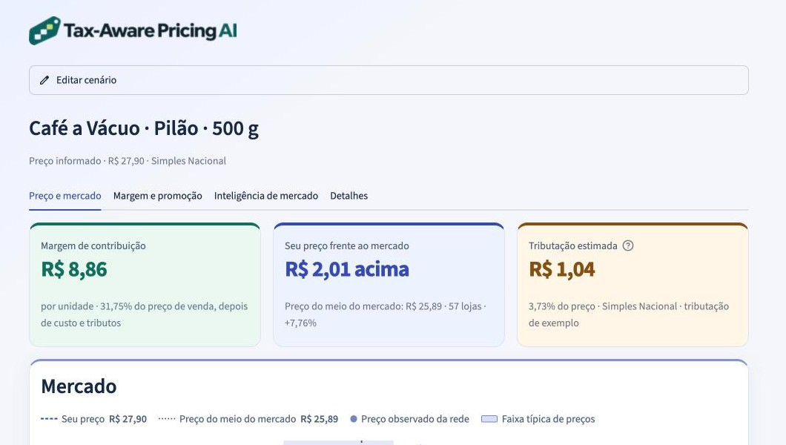
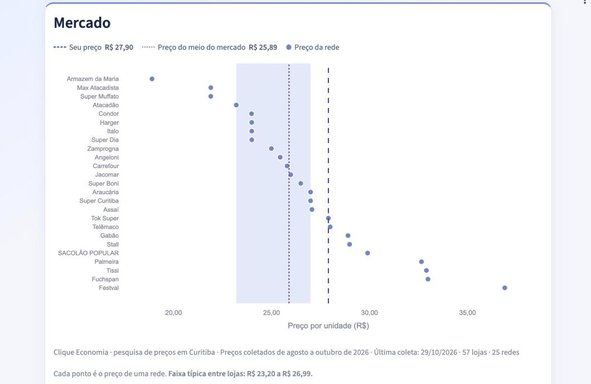
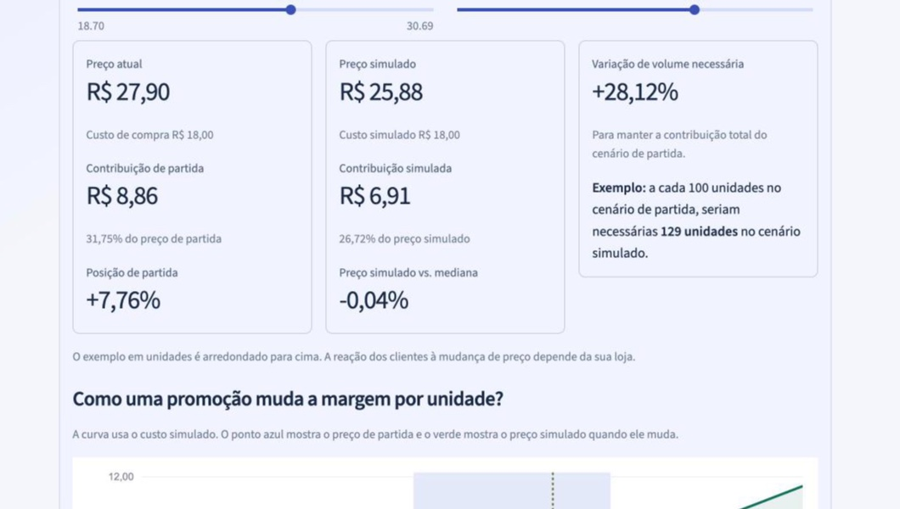
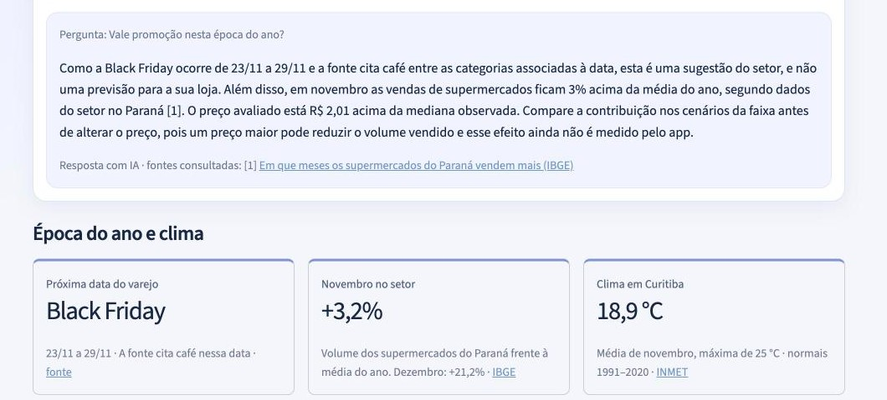

# Tax-Aware Pricing AI

[](https://github.com/pedrocardosojr/tax-aware-pricing-ai/actions/workflows/ci.yml)

A pricing and market-intelligence app for small retailers in Curitiba, developed
by Pedro Cardoso, Eduardo Alves and Rodrigo Campos for the Le Wagon
Data Science & AI final project.

The retailer selects a product and tax regime, enters the acquisition cost, and
either analyses an existing selling price or asks for a price reference.
The app combines the observed market range with contribution margin, an estimated
tax breakdown, price simulations and answers grounded in project sources.
Results are organised in four tabs: price and market, margin and promotion,
market intelligence and details.

**[▶ Open the live app](https://tax-pricing-ai.streamlit.app/)** ·
[Café Pilão demo and validation](docs/cafe_demo_2026-11-19.md) ·
[Run locally](#run-locally)



## Highlights

- **50 real grocery products** with market references built from about 216,000
  public price observations from the City of Curitiba (Clique Economia).
- **Tax-aware contribution margin** for Simples Nacional, Lucro Presumido and
  Lucro Real, plus a 2027 tax-reform (IBS/CBS) sensitivity scenario.
- **Margin and promotion**: current margin, the minimum price that covers cost and
  taxes, and the sales volume a discount needs to keep the same total contribution.
- **Sourced answers (RAG)**: TF-IDF retrieval over a curated corpus and a
  language model that may only use retrieved excerpts and calculated facts;
  numbers and citations are checked before anything is shown.
- **Market intelligence**: sector seasonality (IBGE), climate (INMET), retail
  calendar and a 7-day weather forecast as context.
- **Engineering**: 203 automated tests, lint and type checks in GitHub Actions.

**Stack:** Python · pandas · scikit-learn · Plotly · Streamlit · Gemini API
(OpenAI-compatible endpoint) · official RTC tax calculator · GitHub Actions.

| Market range and network prices | Margin and promotion | Sourced answers |
|---|---|---|
|  |  |  |

This public repository is the portfolio snapshot of the project. The team
develops in a private working repository; this copy is refreshed at milestones.

## Business problem

A retailer needs to understand how much each sale contributes after acquisition
cost and estimated taxes, and how the proposed price compares with competitors.
Brazil's consumption-tax reform introduces IBS and CBS during a transition in
which the tax context and the business regime matter.

This project connects product-level market evidence to that pricing decision.
The app shows its demonstrative tax assumptions and keeps the official RTC
IBS/CBS calculation distinct from the tax deductions used in the margin.

## Run locally

Use Python 3.12, as in CI. In the repository root:

```bash
python -m venv .venv
source .venv/bin/activate
python -m pip install -r requirements.txt
make team-preview
```

Open the local URL printed by Streamlit, usually
[http://127.0.0.1:8501](http://127.0.0.1:8501).

The bundled references cover all 50 selected SKUs. An explicitly configured
`TAX_PRICING_MARKET_DIR` overrides that dataset. Remove an old override to use
the team's final bundled references.

For development checks:

```bash
python -m pip install -r requirements-dev.txt
make test lint typecheck
```

## Data and methods

| Layer | Source and method |
|---|---|
| Market prices | [Clique Economia, Curitiba](https://dadosabertos.curitiba.pr.gov.br/conjuntodado/detalhe?chave=245ef1b9-f82a-42ed-a711-1dec4ccd4be1). Monthly observations plus the October daily supplement. Positive regular prices, deduplication and product-specific checks. |
| Product identity | The production price pipeline uses reviewed catalogue EANs. Description matching and NLP were investigated to recover candidate records, with brand, variant and package checks before accepting links. |
| Market range | One median per store-month, then per store. P25/P50/P75 describe the distribution across stores. Each chart point summarises one network. A three- or six-month window is selected per SKU using the team's bootstrap precision rule. |
| Fiscal reference | [Receita Federal NCM](https://www.gov.br/receitafederal/pt-br/assuntos/aduana-e-comercio-exterior/classificacao-fiscal-de-mercadorias/download-ncm-nomenclatura-comum-do-mercosul), a team-reviewed EAN–NCM catalogue checked against the official table (raw responses from the lookup service used during research are not redistributed), and the [official RTC calculator](https://consumo.tributos.gov.br/servico/calcular-tributos-consumo/calculadora/calculadora-offline). |
| Contribution | Python computes selling price minus net acquisition cost and estimated sale taxes. Profiles for Simples Nacional, Lucro Presumido and Lucro Real are demonstrative and versioned. |
| Price simulation | The same calculation is rerun at another price. The app reports the contribution and volume change required to preserve the original total contribution. |
| 2027 tax transition | The [official timeline](https://www.gov.br/fazenda/pt-br/acesso-a-informacao/acoes-e-programas/reforma-tributaria/perguntas-e-respostas/como-sera-a-transicao-para) is paired with a contribution sensitivity analysis for the selected SKU. The app holds price, acquisition cost and purchase credits constant and varies sales taxes by one percentage point. These scenarios use illustrative changes, with no assumed statutory 2027 effective rate. |
| Forecast | The model uses the monthly price archive and the October daily supplement, like the market reference. Details compares the latest observed network prices with next-month estimates and shows the results of a temporal backtest. The market range in the main view summarises stores across a longer window. |
| Retrieval and language model | TF-IDF over words and character fragments retrieves excerpts from the curated corpus. The configured model answers using those excerpts and calculated scenario facts. Citations and numerical membership are checked before display. |
| Seasonal context | Versioned [IBGE supermarket-sector data](https://sidra.ibge.gov.br/tabela/8882), [INMET climate normals](https://portal.inmet.gov.br/normais) and sourced retail-calendar research. These describe sector signals. |

The final batch has 50 SKUs across 12 groups. Forty-one have a current reference
within the team's precision threshold, five carry a low-precision warning and
four beers have historical references. All 50 can be analysed with a supplied
selling price. The 46 non-historical references expose a market-range scenario.
The dates and coverage are visible on screen.

See [the export method](mercado/exportar.py),
[dataset documentation](dados/README.md) and
[the published batch status](evidencias/referencias_edu_2026-11-10/status_50.csv).

## Optional model connection

The app accepts these settings as environment variables or root-level
Streamlit Secrets:

```toml
OPENAI_API_KEY = "<provider API key>"
TAX_PRICING_LLM_MODEL = "<tested model identifier>"
TAX_PRICING_LLM_URL = "https://generativelanguage.googleapis.com/v1beta/openai/chat/completions"
```

The key name is retained for endpoint compatibility. The URL above uses Google's
Gemini compatibility endpoint. Keep credentials outside version control.

The **Resumo do preço** block displays approved scenario insights, with the
model optionally prioritising their order. **Inteligência de mercado** answers
a clicked or typed question using retrieved sources. When generation is unavailable
or rejected, the app retains its calculated insights and source excerpts.

The model does not calculate prices or taxes. Numerical and citation checks
reduce errors but do not establish that every generated statement is correct.
The [Café review](docs/cafe_demo_2026-11-19.md) records the actual test cases.

## Official tax detail

To query the RTC, run the official engine separately and configure
`TAX_PRICING_RTC_API` if its URL differs from `http://127.0.0.1:8080/api`.
Without that service, the official IBS/CBS detail is marked unavailable.
The demonstrative contribution calculation remains usable.

The app's fiscal date is versioned in
[dados/tributos/perfis_demo_mvp.json](dados/tributos/perfis_demo_mvp.json).
Displayed market prices are dated observations.

## Interpretation

- Contribution margin is the amount left before fixed costs and other omitted
  business expenses.
- The tax estimate depends on the selected product and demonstrative profile.
  It does not replace an accountant's company-specific assessment.
- P25–P75 is a central observed price range. It is distinct from the bootstrap
  confidence interval used to assess reference precision.
- A market reference does not establish an optimal price or measure demand
  elasticity. Required sales volume is a break-even scenario.
- Historical, low-precision, exploratory and forecast views are labelled.
  The historical charts may use a different population and period from the
  team's principal reference.

## Team

| Author | Main contribution |
|---|---|
| [Pedro Cardoso](https://github.com/pedrocardosojr) | Business scope, tax integration, contribution and pricing simulations, Streamlit integration, sourced explanations and demo coordination. |
| [Eduardo Alves](https://github.com/EduardoLuizAlves) | Market statistics, reference exports and integration, price forecasting and analytical outputs. |
| [Rodrigo Campos](https://github.com/rodricamp) | Product catalogue and identity review, data cleaning, reference-method comparison, precision analysis and interface feedback. |

## Resumo em português

Aplicação de pricing e inteligência de mercado para pequenos varejistas.
O usuário escolhe produto, regime tributário e custo de aquisição e informa
um preço de venda ou pede uma referência. A ferramenta mostra margem de
contribuição, tributação estimada, posicionamento frente à concorrência e o
efeito de simular outro preço. A camada de RAG responde perguntas com fontes
sobre o método e o contexto do varejo.

Projeto final do bootcamp Le Wagon Data Science & AI, com Demo Day em 28/11/2026.
As premissas fiscais são demonstrativas e a data de cada referência de mercado
permanece visível.

## License

Released under the [MIT License](LICENSE). Market prices come from the City of
Curitiba open-data portal and official tax tables keep their own terms.

## Project records

[Source and tax review](docs/revisao_fiscal_2026-11-09.md) ·
[Market analysis methods](docs/analises_mercado_mvp.md) ·
[Retrieval and generation experiments](pesquisas/ia_fontes_2026-11-14/README.md)

In the team's working repository, work was integrated through feature branches
and pull requests, with tests, lint and type checks in GitHub Actions.
