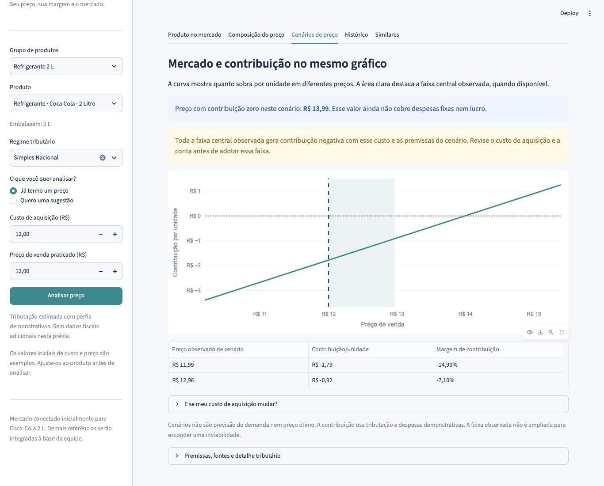
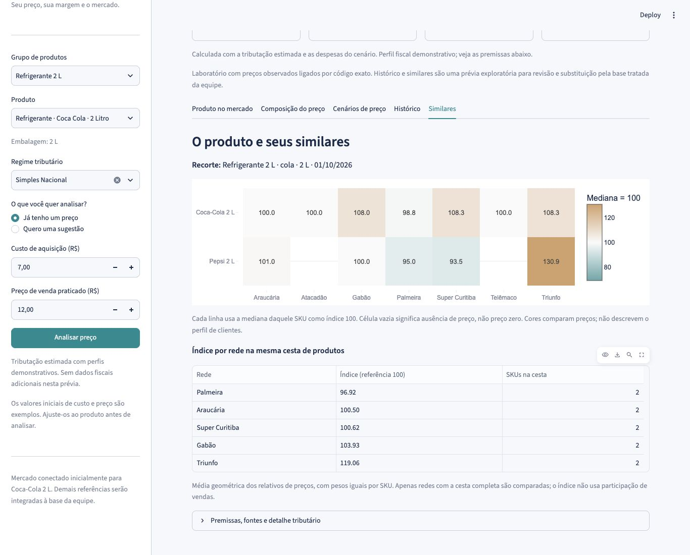

# Laboratório de mercado e contribuição — 07/11/2026

Prévia funcional aprovada por Pedro para testar os métodos antes de receber
a base tratada de Edu e Rodrigo. Implementação isolada na branch
`feat/pedro-streamlit`, PR #9. Os pipelines dos colegas e o catálogo original
não foram alterados. Perfil de clientes dos concorrentes continua fora do MVP.

## O que já pode ser experimentado

| Visão | Cálculo / gráfico | População |
|---|---|---|
| Concorrência | Mediana por rede, depois mediana entre redes | Mesmo SKU, data e preço regular |
| Posicionamento | Redes abaixo, empatadas e acima; diferença em R$/% | Uma referência por rede, sem peso por quantidade de lojas |
| Dispersão | Boxplot, P25/P75, IQR e IQR/mediana | Quartis com interpolação linear; hastes mínimo/máximo |
| Contribuição | Curva preço × contribuição e primeiro centavo não negativo | Mesmo perfil fiscal demonstrativo já usado no MVP |
| Custo | Heatmap custo × preço, de −20% a +20% do custo informado | Hipóteses comerciais, não novos preços observados |
| Histórico | Mediana e P25/P75 por mês, com cobertura | Última observação por loja no mês da foto |
| Similares | Heatmap SKU × rede com mediana de cada SKU = 100 | Mesmo grupo, tipo, apresentação e data |
| Cesta | Média geométrica dos relativos por SKU | Só redes com a mesma cesta completa; pesos iguais por SKU |

## Experimento observado e resultados

Fonte versionada: `dados/clique_economia_mensal_2024_2026.parquet`.
Recorte inicial por **código exato do catálogo**, sem fuzzy matching,
recuperação de aliases ou correção dos dados dos colegas.

- Coca-Cola 2 L, EAN 7894900027013, em 01/10/2026: nove lojas, sete redes.
- Mediana entre redes: **R$ 11,99**. Média das lojas: **R$ 12,30**;
  média das referências das redes: **R$ 12,39**.
- Preço de R$ 12: quatro redes abaixo, nenhum empate, três acima.
- Histórico de **25 meses**; no último intervalo não há lojas repetidas
  pelo identificador adotado. Não foi publicada variação pareada nesse caso.
- Comparativo exploratório: Coca-Cola e Pepsi, ambas cola de 2 L.
  Pepsi tem preços em cinco redes; cinco redes têm os dois SKUs na mesma data.
- Células sem observação ficam vazias. O índice da cesta não representa
  toda a categoria, participação de mercado nem perfil de clientes.

O catálogo original descreve Pepsi com uma menção adicional a Coca Cola.
A descrição foi preservada. Um nome de exibição separado foi usado no
gráfico; identidade e descrição precisam de revisão da equipe.

Arquivos: [manifesto e hashes](../evidencias/market_lab_2026-11-07/manifest.json),
[checagens do experimento](../evidencias/market_lab_2026-11-07/checks.json),
[snapshot](../evidencias/market_lab_2026-11-07/7894900027013.json) e
[histórico/similares](../evidencias/market_lab_2026-11-07/7894900027013_analytics.json).

## Cruzamento econômico testado

Com **custo fictício de R$ 12**, no perfil demonstrativo do Simples:

| Preço | Contribuição/unidade |
|---|---|
| R$ 11,99 | −R$ 1,79 |
| R$ 12,96 | −R$ 0,92 |

O primeiro centavo com contribuição não negativa é **R$ 13,99** nessas
premissas. A tela avisa que a faixa central observada inteira gera
contribuição negativa. O piso não é preço ótimo, não cobre despesas fixas
e não promete que o consumidor comprará nesse valor.

A curva reutiliza o cálculo comercial e não faz uma chamada RTC para cada
ponto. Sensibilidade recalcula o perfil e o crédito hipotético para cada
custo. Não foi acrescentado input de meta de margem ou de dados fiscais.

## Conectar a base tratada

Configurar `TAX_PRICING_MARKET_DIR` com arquivos por SKU:

- `<EAN>.json`: snapshot já descrito no [guia da tela](streamlit_preview.md).
- `<EAN>_analytics.json`: complemento opcional, `schema_version: 1`, `ean`,
  `date` igual ao snapshot, `source`, `review_status`, `history` e `comparables`.
- `history`: lista mensal ordenada, sem períodos repetidos, com EAN/origem
  observada, fonte, `period`, `date` âncora do mês, P25/mediana/P75,
  número de redes/lojas, datas de coleta e campos de comparação pareada.
- `comparables`: snapshots observados na mesma data, com EAN, descrição,
  grupo, tipo, embalagem e `per_network_brl`. O SKU selecionado deve estar
  presente. Embalagens ou tipos diferentes são rejeitados nesta versão.

O JSON experimental acima funciona como exemplo completo. Para identificar
uma entrega já revisada, usar `review_status: "team_validated"` apenas após
a conferência do grupo. Arquivo ausente não usa silenciosamente uma base
de exemplo. Complemento incompatível fica indisponível, sem apagar a margem.

Para recalcular a partir de observações, `summarize_quotes` recebe `ean`,
`date`, `network`, `store`, `price` e `price_kind: "regular"`.
Duplicatas idênticas não ganham peso; preços conflitantes na mesma chave
exigem revisão. Identidade da loja usa código da empresa ou, quando falta,
endereço completo normalizado, com essa escolha registrada.

No histórico, a origem `period` é o mês do snapshot. Datas efetivas de
coleta são preservadas. O pareamento exige a mesma loja dentro da mesma rede,
meses consecutivos e mínimo operacional provisório de três redes repetidas.
Esse limite não é garantia de representatividade estatística.

## Reproduzir e revisar

```bash
python -m pip install -r requirements-dev.txt
make market-lab
make test lint typecheck
make app
```

Código: `tax_pricing/market_statistics.py`, `tax_pricing/pricing_scenarios.py`,
`tax_pricing/ui/analytical_charts.py` e `tax_pricing/ui/lab_view.py`.
O gerador `scripts/build_market_lab.py` só escreve a evidência do laboratório.

Validação: **103 testes aprovados**, pylint **10/10**, mypy sem erros em
**34 arquivos**, além da conferência visual dos gráficos. Casos incluem
duplicatas/conflitos, pesos por rede, empates, falta de meses, troca de lojas,
coortes incompatíveis, células vazias, contribuição negativa, piso em
centavos e complemento inválido. Nenhum novo lote RTC real foi executado.

Próxima revisão com Edu/Rodrigo: validar os vínculos/lojas, alimentar os
mesmos contratos com a base tratada, ampliar cobertura por SKU/coorte e
revisar a interpretação e os parâmetros. Previsão, elasticidade, sugestões
de preço ótimo e normalização de apresentações diferentes não foram liberadas.



