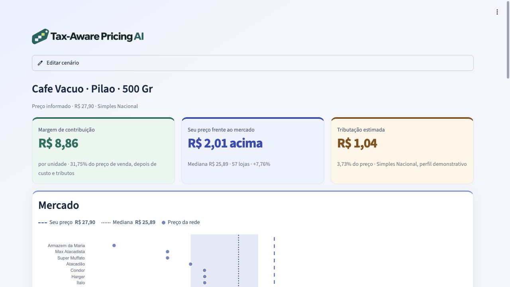
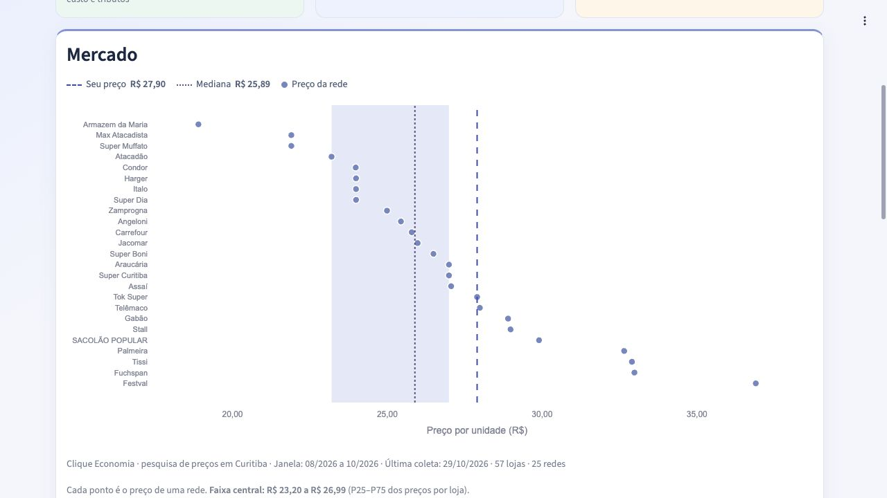
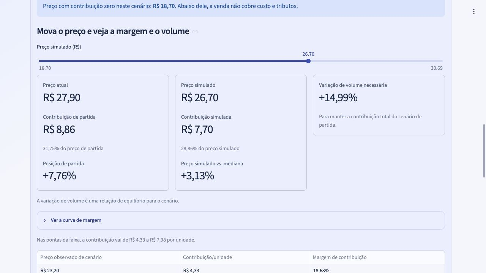
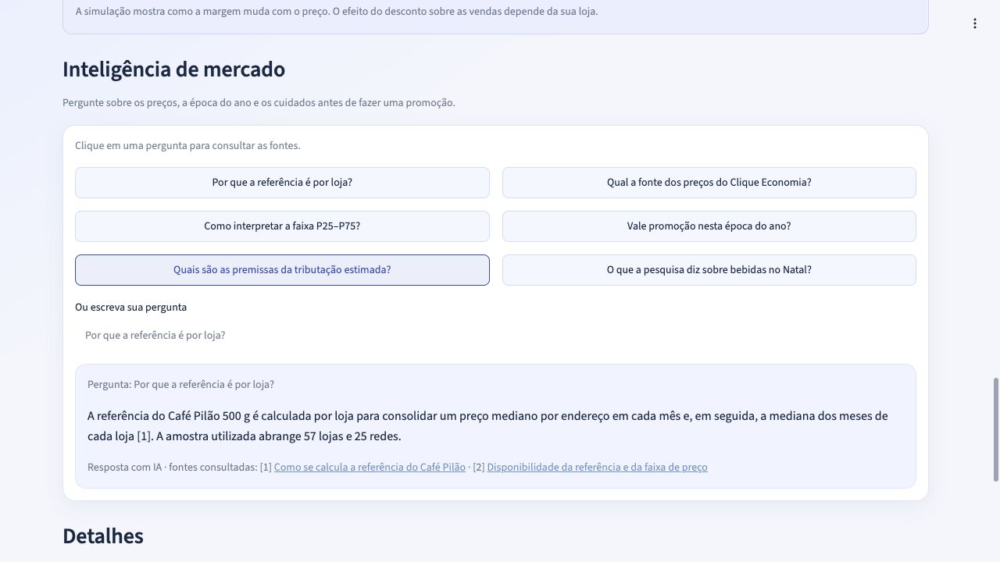

# Café Pilão · revisão para a demonstração

Validação realizada em 19/11/2026 sobre a main `268acfb` e os ajustes desta
revisão. Produto **Café a vácuo Pilão 500 g**, EAN **7896089011357**.

## Cenário reproduzível

Selecione **Café → Café vácuo Pilão 500 g → Simples Nacional**.
Use custo de aquisição **R$ 18,00** e preço de venda **R$ 27,90**.
Esses dois valores são fictícios para o ensaio.

| Indicador | Resultado |
|---|---:|
| Margem de contribuição por unidade | R$ 8,86 |
| Margem sobre a venda | 31,75% |
| Tributação estimada na venda | R$ 1,04 |
| Mediana de mercado | R$ 25,89 |
| Diferença frente à mediana | R$ 2,01 acima, ou 7,76% |
| Faixa central por loja | R$ 23,20 a R$ 26,99 |
| Cobertura | 57 lojas, 25 redes, 200 observações |
| Janela | agosto a outubro de 2026 |
| Última coleta | 29/10/2026 |

Em **Sugira um preço**, com o mesmo custo e regime, o cenário de referência
é **R$ 25,89**, com margem de **R$ 6,92** e tributação estimada de **R$ 0,97**.
A conta usa a precisão interna. Os números exibidos são arredondados ao final.

## Mercado e gráficos

O gráfico principal mostra as 25 redes, enquanto a faixa e a mediana vêm das
57 lojas. Há preços entre R$ 18,90 e R$ 36,90. Esses extremos foram mantidos.
O Café também tem dispersão, e a faixa central ajuda a explicar a comparação.

Foram conferidos o gráfico principal, a simulação e a curva de margem,
a composição do preço, o histórico mensal, o mapa de calor e as fontes
da sazonalidade. Os gráficos históricos são exploratórios e podem ter
recorte e período diferentes da referência principal.

Na simulação a **R$ 26,70**, a margem cai para **R$ 7,70** e seria necessário
vender aproximadamente **14,99%** mais unidades para manter a contribuição
total do cenário de R$ 27,90. Essa relação é aritmética, sem estimar a reação
dos consumidores ao desconto.

## Perguntas para demonstrar

1. **Por que a referência é por loja?** Explica loja-mês → loja e os pontos
   por rede, com fonte do método.
2. **Como interpretar a faixa P25–P75?** Explica a metade central dos preços
   por loja e a diferença em relação a um intervalo de confiança.
3. **Vale promoção nesta época do ano?** Usa o contexto setorial e o calendário.
   Para café, o calendário de Black Friday tem fonte que cita a categoria.
4. **Quais são as premissas da tributação estimada?** Explica o perfil escolhido.
   Neste cenário do Café, a estimativa é pelo DAS. ICMS-ST retido na compra
   não é uma premissa deste cenário.
5. **O Café está em promoção hoje?** Deve informar que o app não consulta
   promoções em tempo real.

A pergunta sobre bebidas no Natal continua disponível como contexto de outras
categorias. Seus resultados não descrevem a venda de café.

## Método e resultados do teste

- Seis fluxos de interface executados com AppTest: três regimes, preço
  informado e sugestão. O RTC foi simulado como indisponível nessa rodada.
- Em cada fluxo, conferidos SKU, mediana, 57 lojas, 25 redes e reconciliação
  entre receita, custo, tributos, despesas e margem.
- Sete perguntas respondidas pelo Gemini configurado, com chave fora do Git.
  Duas perguntas fora do escopo recusadas antes da chamada ao modelo.
- Os sete retornos salvos passaram pela checagem final de números e citações.
  Tempo médio de chamada ao modelo de aproximadamente **1,10 s**, com pausa
  entre solicitações. Essa medida não é a latência completa do app.
- Esta rodada é revisão de demonstração, com correções orientadas pelos erros
  encontrados. Ela não é uma nova avaliação cega de generalização.
- Conferência no navegador incluiu uma resposta real, a fonte visível,
  a troca de preço no simulador e as capturas desta página.

A revisão encontrou e corrigiu uma generalização de ICMS-ST no acervo e uma
explicação incompleta de P25–P75. O prompt passou a receber as premissas do
produto escolhido. A validação também reconhece os nomes dos novos fatos do
cenário quando o modelo os marca entre colchetes. Fontes citadas continuam
restritas aos trechos recuperados.

Os retornos originais e os resultados após as correções estão em
[evidencias/cafe_demo_2026-11-19](../evidencias/cafe_demo_2026-11-19).
As respostas são evidências de teste e não orientação fiscal.

## Apresentação ao público

As capturas usam o modo de visitante do Streamlit. A fonte de mercado aparece
como “Clique Economia · pesquisa de preços em Curitiba”. Nomes de integrantes,
caminhos de arquivos, identificadores de commits e mensagens de implementação
ficam na documentação. As premissas demonstrativas, datas e fontes que ajudam
a interpretar o resultado permanecem acessíveis na tela.

A liberação pública do app foi autorizada em 19/11 e aguarda o login da conta
administradora no Streamlit Cloud.

## Aceite da equipe

Edu confere a população da referência, a faixa e o CSV. Rodrigo confere
legibilidade e navegação no projetor. Pedro conduz a decisão de preço e
a pergunta com fonte. O cenário pode ser ensaiado localmente com
`make team-preview`. O acesso externo ao app e ao repositório depende
das permissões configuradas.
