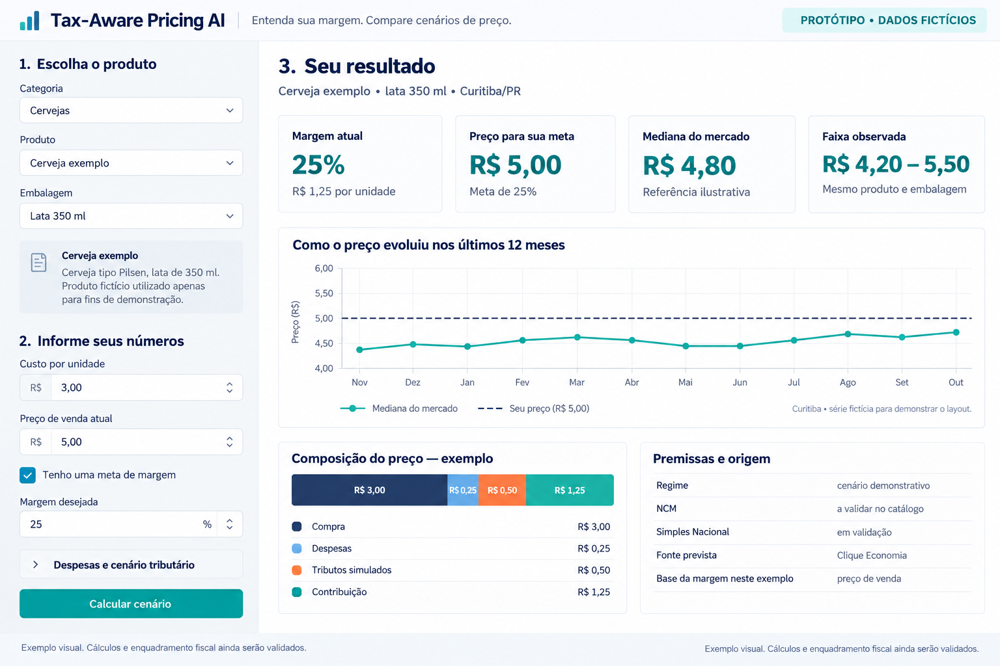

# Escopo de trabalho — reunião de 27/10/2026

A direção atual do produto está no [fluxo de referência de 05/11](fluxo_vigente.md).
Este documento preserva o histórico da reunião.

## Decisões relatadas por Pedro

- Primeiro fluxo com catálogo selecionável: categoria, produto e embalagem.
- Sem upload de planilha ou descrição livre do usuário na primeira entrega.
- Custo de compra informado numericamente; meta de margem opcional.
- Vínculo de produto e classificação fiscal conferido no catálogo interno.
- Interface proposta em Streamlit; começar pela discussão do resultado visual.
- Localidade fixa nesta entrega: Curitiba/PR, identificada no resultado; sem seletor de cidade.

## Resultado que queremos explorar

Margem em um preço informado, preço para atingir uma meta, referência de preço em Curitiba e histórico do mesmo produto/embalagem. Exibir origem, datas, cobertura e premissas dos tributos.

Estas saídas são a direção da discussão, não uma lista de funcionalidades já implementadas. O conjunto mínimo da primeira tela ainda será escolhido pelo grupo.

## Pontos ainda abertos

1. Produtos da primeira carteira e SKU inicial para integração.
2. Preço atual: entrada do usuário ou referência escolhida? Custo e tributos sozinhos não determinam margem atual. Sem preço atual, nomear a saída como margem em um preço de referência.
3. Quando não há meta: mostrar cenários ou pedir escolha de preço? Não inventar uma meta do empresário.
4. Base da margem, despesas variáveis e conversão de unidade/caixa/fardo.
5. Mediana ou média; significado da faixa; indicador de posicionamento; cobertura mínima e meses ausentes no histórico.
6. Perfis tributários efetivamente suportados, datas e regras de crédito.
7. Comparação entre regimes como extensão a avaliar. Distinguir regime da empresa de apuração de IBS/CBS; não recomendar troca com base apenas em um SKU.
8. Camadas de IA/DS a explorar com o grupo: análise de mercado, preparação do catálogo e explicação de resultados. O projeto já foi aprovado; mostrar evolução ao professor para feedback, sem nova aprovação como pré-requisito. Não presumir novo modelo ou previsão já definida.
9. Responsáveis, disponibilidade e prazos de cada entrega.

## Mockup para discutir a experiência

A imagem foi gerada como referência visual. Valores e série histórica são fictícios. Cerveja é apenas exemplo de tela, sem validação fiscal implícita. A composição usa uma convenção ilustrativa e não substitui a convenção comercial do grupo. Comparação de regimes ainda não está desenhada como resultado funcional.

## Sequência sugerida para o início do desenvolvimento

1. Revisar o mockup e escolher entradas e outputs mínimos.
2. Escolher um SKU presente na base e conferir vínculo com NCM/enquadramento.
3. Preparar referências e histórico de mercado; definir cálculo comercial/fiscal suportado.
4. Integrar um SKU na interface.
5. Outro integrante reproduzir e conferir cenários, limites e erros de entrada.

## Onde acompanhar

- Trello
- Revisão do mockup
- Referência e histórico de mercado
- Proposta de comparação tributária
- [Bases, fontes e leitura](../dados/README.md)
- [Calculadora e API local](api_receita.md)

A organização de tarefas não significa aprovação ou conclusão das pendências. Uma tarefa por branch, PR e revisão de colega antes de incorporar à main.

## Pesquisa paralela de DS e IA

[Possibilidades, fontes e primeiros testes](pesquisa_ds_ia.md). Posicionamento, dispersão e evolução são candidatos de DS; correspondência de produtos e explicações são candidatos de IA. NCM nos bastidores pode apoiar a expansão do catálogo. São possibilidades para discutir, sem novas medições ou obrigação de implementação.
