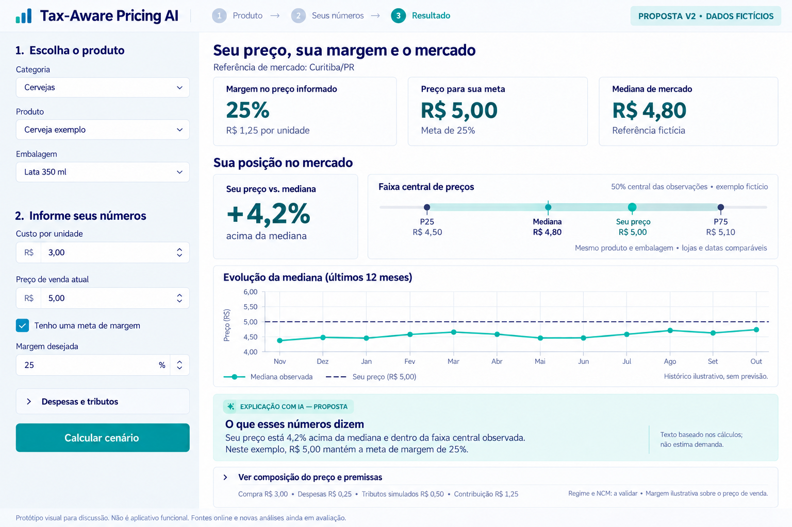

# Mockup v2 — proposta de resultado com DS e IA

Status: exploração visual para discussão do grupo. A v1 permanece preservada; esta proposta não fecha o escopo nem implementa funcionalidades.

## O que a imagem explora

- Fluxo: produto selecionável → números do negócio → resultado.
- Cálculos: margem no preço informado e preço para a meta opcional.
- Data Science: posição frente à mediana, faixa central P25–P75 e evolução histórica da mediana.
- IA: uma explicação curta baseada nos cálculos e referências apresentados.

A faixa central descreve a dispersão dos preços, não um intervalo de confiança. O histórico é observado/ilustrativo, não previsão. A amostra visual usa custo R$3,00, preço R$5,00, contribuição R$1,25 e base ilustrativa sobre preço de venda. Não substitui a convenção econômica e o perfil fiscal que o grupo vai definir.

## O que continua aberto

Inputs/outputs mínimos, fontes comparáveis, despesas, convenção de margem, perfil fiscal, critérios de cobertura e utilidade da explicação. Dados online e métodos adicionais seguem em avaliação, sem nova medição.

Revisar com o grupo no Trello · [Pesquisa DS e IA](pesquisa_ds_ia.md) · [Escopo](escopo.md)

## Ajuste do recorte geográfico

Curitiba/PR é contexto fixo, não entrada selecionável. O campo Localidade foi retirado da proposta visual: a base consolidada tem 215.931 registros e 119 endereços distintos, todos com sufixo Curitiba/PR na conferência de endereços. A checagem confirma a localidade informada no arquivo, não uma nova geocodificação das lojas. O resultado deve indicar “Referência de mercado: Curitiba/PR”. Ampliação para outras cidades depende de novas fontes comparáveis.
