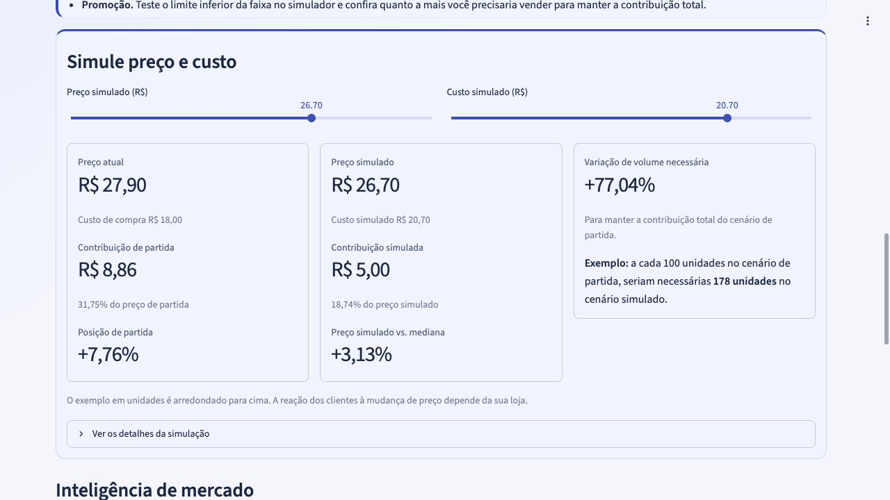

# Prévia para sábado · simular preço e custo

Proposta baseada nas três sugestões do Rodrigo no Trello em 19/11.
Branch de revisão `feat/simulador-preco-custo`. A escolha do layout final
fica para o ensaio de 21/11.

## O que foi testado

- Simulação aberta logo após o resumo, com dois sliders.
- Custo e preço ajustáveis, comparando o cenário original com o simulado.
- O custo simulado refaz os créditos e os tributos do perfil escolhido.
- A comparação de volume sempre usa a contribuição original como base.
- Exemplo “a cada 100 unidades” com o total necessário no cenário simulado,
  arredondado para cima.
- Contribuições zero ou negativas mostram aviso e deixam a comparação de
  volume indisponível.
- Curva, piso de contribuição e tabela de preços ficam em detalhes recolhidos.
  Eles usam o custo selecionado no simulador.

## Exemplo do Café Pilão

Partida fictícia no Simples: venda a R$ 27,90 e aquisição a R$ 18,00.

| Simulação | Margem/unidade | Volume para preservar a contribuição |
|---|---:|---:|
| Venda a R$ 26,70, custo R$ 18,00 | R$ 7,70 | +14,99%, ou 115 para cada 100 unidades |
| Venda a R$ 26,70, custo R$ 20,70 | R$ 5,00 | +77,04%, ou 178 para cada 100 unidades |

São exemplos aritméticos. A aplicação não conhece as vendas nem prevê
o aumento de volume da loja.



## Evidências

- **192 testes automatizados**, lint e checagem de tipos.
- **1.728 combinações de preço e custo** em 50 SKUs, três regimes e nos
  caminhos de preço informado ou referência de mercado. Os resultados
  reconciliam margem, tributos e unidades necessárias.
- As 12 tentativas de sugestão referentes às quatro cervejas históricas
  foram mantidas como ausência de referência atual.
- O RTC foi simulado como indisponível. Mover os controles não faz novas
  chamadas ao motor fiscal.
- Navegador: os dois controles, atualização simultânea, comparativo de volume,
  aviso de perda e leitura em tela estreita foram conferidos.
- [Resultados por combinação](../evidencias/simulador_preco_custo_2026-11-19/cases.csv)
  e [resumo](../evidencias/simulador_preco_custo_2026-11-19/summary.json).

## Revisão de sábado

Pedro conduz os cenários e confere a conta. Rodrigo revisa se os controles
e os exemplos ficam claros. Edu confere a leitura da referência e da curva
quando o custo muda. Confirmar também a opção de mostrar o volume em
unidades por 100 e o nível de detalhe desejado.

Para abrir esta proposta localmente:

```bash
git fetch origin
git switch --track origin/feat/simulador-preco-custo
make team-preview
```

Se a branch já existir no computador, use `git switch feat/simulador-preco-custo`
e atualize-a antes de executar o app.
